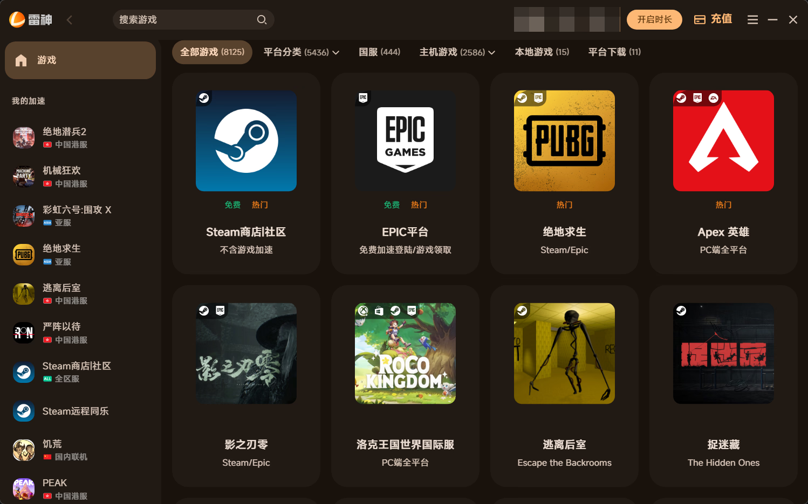
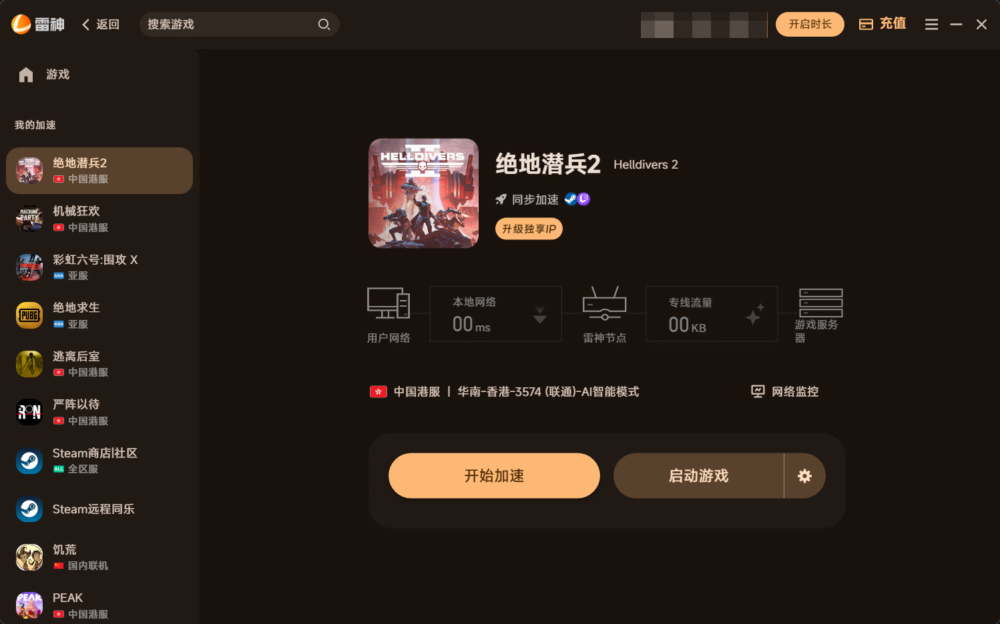
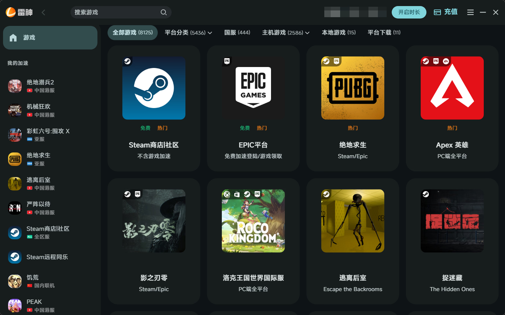
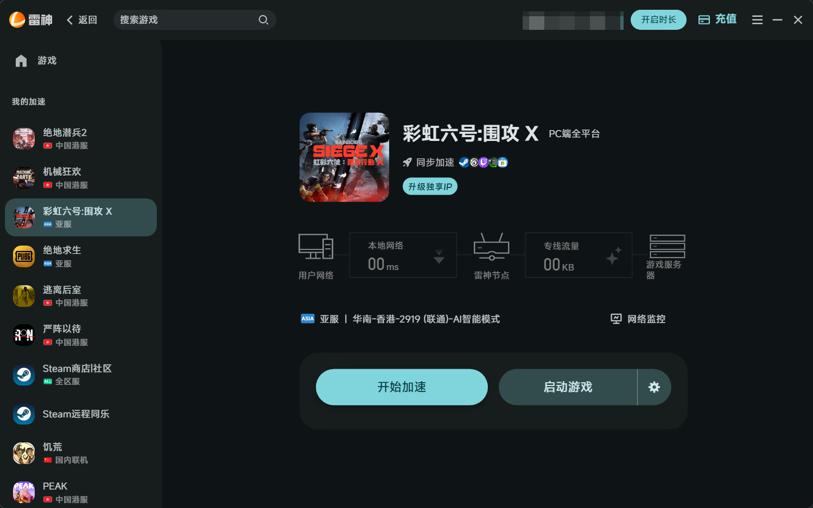

# Gameware Cleaner

**雷神加速器一键精简：去广告、去捆绑、换上 M3E 主题，随时一键还原。**

[**下载**](https://github.com/TG-Twilight/Gameware-Cleaner/releases/latest) · [效果](#效果) · [使用](#使用) · [还原](#还原) · [常见问题](#常见问题)

> [!IMPORTANT]
> **用过 0.10.0～0.12.0 并开了取色，开机后会弹出空白终端窗口？**
> 那是旧版的常驻取色助手。下载新版后双击 `Fix-Startup-Window.cmd` 即可关闭（不改雷神，不需要管理员）；
> 直接重新运行新版一键脚本也会自动清理。

## 效果

  
   首页（不取色，雷神橙）

  
   游戏详情页（不取色，雷神橙）

<b>开启取色后的样子</b>（跟随 Windows 主题色，点击展开）

 

  
   首页（取色，初音绿）

  
   游戏详情页（取色，初音绿）

## 功能

| | 功能 | 说明 |
|:-:|---|---|
| 🧹 | 去广告 | 首页横幅、列表插卡、顶栏口号与搜索轮播、详情页社区侧栏与底部推广条，并重新排版 |
| ⏱️ | 省时长 | 点“停止加速”同时暂停时长；计时开着但连续 3 分钟没加速时自动暂停 |
| 🎨 | M3E 主题 | Material 3 Expressive 外观；默认跟随 Windows 主题色（取色），关闭取色则为雷神橙 |
| 📦 | 精简 | 捆绑工具、更新残留移出安装目录；重复运行库改为硬链接，约省 160 MB |
| 🔒 | 冻结更新 | 停用更新程序并拦截更新域名（可关） |
| ↩️ | 可还原 | 只隔离不删除，每次运行都生成带 `restore.cmd` 的备份 |

所有功能都会逐项用中文 Y/N 询问。登录、加速引擎、驱动、付费与授权逻辑一律不动。

## 使用

> 运行前请先阅读[免责声明](docs/DISCLAIMER.md)。

1. 到 [**Releases**](https://github.com/TG-Twilight/Gameware-Cleaner/releases/latest) 下载 `LeiGod-OneClick-<版本>.zip`，**完整解压**。
2. 完全退出雷神（包括托盘图标）。
3. 双击 `Run-LeiGod-OneClick.cmd`，UAC 弹窗点“是”。
4. 按提示输入 **Y** / **N**，直接回车用默认值。
5. 完成后记下备份位置，按任意键退出，再打开雷神。

**取色**只在运行脚本时读一次 Windows 主题色（设置 → 个性化 → 颜色 → 主题色），
不装后台程序、不加开机启动项。改了主题色，重新运行一次脚本即可。

## 还原

完全退出雷神，双击备份目录里的 `restore.cmd`。

- 默认备份位置：`%USERPROFILE%\GamewareCleanerBackup\leigod-<时间>`
- 处理过多次时，从最近一次开始依次还原。
- 建议保留备份以便还原；稳定使用几天后，也可以自行删除备份。

## 常见问题

<b>支持哪些版本？</b>

目前只在雷神 Windows 客户端 **11.3.3.2** 上验证过，其他版本不保证兼容。
本仓库只提供脚本，不包含客户端安装包或修改后的客户端文件。

<b>到底能省多少空间？</b>

未精简的 11.3.3.2 第一次运行脚本时，重复运行库改为硬链接约省 **160 MB**（实测样本 158 MB）；
精简还会把约 55 MB 以上的捆绑组件（工具库约 41 MB、应用宝约 14 MB）移出安装目录。

被隔离的文件仍保存在备份里（用户文件夹下），实际效果取决于安装版本、已有文件和所选功能，
以脚本结束时显示的统计为准。稳定使用几天后删除备份，才会真正释放这部分空间。

<b>想换一套功能组合？</b>

选 N 只是这次不添加，不会撤销以前装过的补丁。想重新组合，请先还原再运行。

<b>有什么副作用？</b>

- 冻结更新会同时挡掉官方的安全修复。
- 硬链接可能让客户端日志出现 `ERR_FS_CP_EINVAL`，不影响使用。
- 自动停表需要客户端保持运行，不保证在所有网络和状态下都能及时生效。

## 许可

原创代码采用 [GPL-3.0-only](LICENSE)；内嵌的第三方代码保留原许可，见[第三方声明](docs/THIRD-PARTY-NOTICES.md)。
配色资源的生成方式见[源码说明](docs/SOURCE.md)。

本项目为独立第三方工具，与雷神官方无隶属或合作关系。Copyright (C) 2026 TG-Twilight
