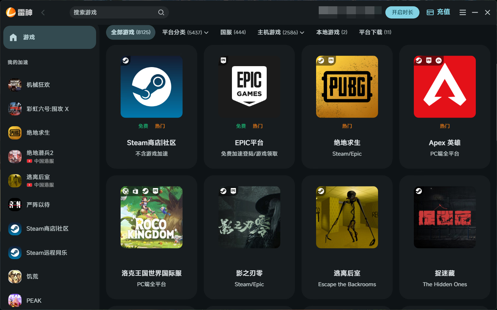
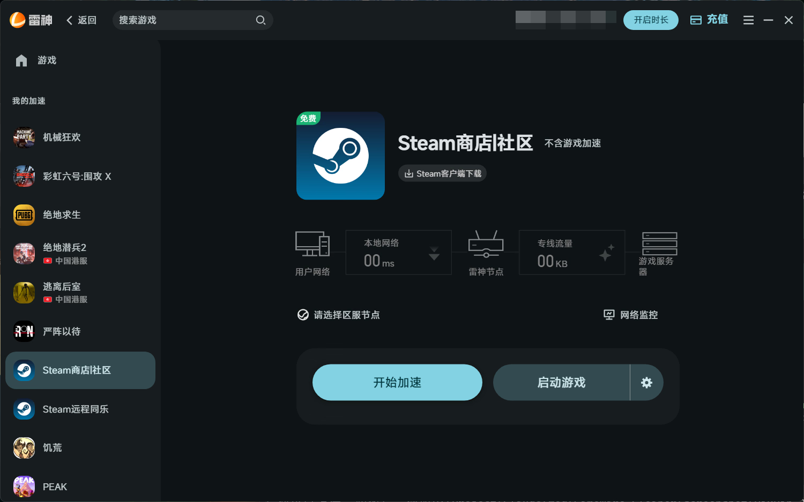

# Gameware Cleaner

Windows 游戏周边软件一键精简脚本，目前支持**雷神加速器**。

当前版本：**0.12.0**。适用于 Windows 10/11，使用系统自带的 Windows PowerShell 5.1，无需额外安装运行时。

## 能做什么

- 移除首页广告、顶栏推广、详情页社区侧栏和底部推广条，并调整布局。
- 隔离捆绑工具和更新残留，通过硬链接减少重复文件占用。
- 可选冻结客户端更新。
- 点击“停止加速”时同时暂停时长；计时开启但连续 3 分钟未加速时自动暂停。
- 可选 M3E 主题，以及跟随 Windows 系统主题色。
- 自动备份，提供还原入口。

各项功能均可在运行时用中文 Y/N 选择。保留登录、加速引擎、驱动、付费和授权逻辑。

## 目前支持

| 软件 | 已验证版本 |
|---|---|
| 雷神加速器 Windows 客户端 | 11.3.3.2 |

其他版本尚未验证，不能保证兼容。本仓库仅提供一键脚本，不包含客户端安装包或修改后的客户端文件。

## 大概能省多少空间

首次处理未精简的雷神 11.3.3.2、开启“节省空间”时，**重复运行库合并为硬链接这一项可节省约 160 MB**（已有实测样本约 158 MB）。精简工具还可将约 55 MB 以上的捆绑组件移出安装目录，例如工具库约 41 MB、应用宝约 14 MB；更新残留和缓存的大小因使用情况而异。

隔离文件会保留在备份中，**移出安装目录不等于立即释放磁盘空间**；渲染层备份也会新增占用，因此总磁盘空间的净释放量会低于上述硬链接节省量。具体取决于安装版本、已有文件和所选功能，以脚本结束时的隔离及硬链接统计为参考。请保留备份以便还原。

## 效果展示

以下为开启 M3E 主题后的示例，配色可随 Windows 系统主题色变化。

首页：

游戏详情页：

## 怎么用

运行前请阅读[免责声明](docs/DISCLAIMER.md)，保留备份。

1. 点击本页 **Code → Download ZIP**，下载并解压全部文件。
2. 完全退出雷神，包括托盘中的雷神。
3. 双击 `Run-LeiGod-OneClick.cmd`，在 UAC 提示中允许以管理员运行。
4. 按提示输入 **Y** 开启、**N** 跳过，回车使用默认值。
5. 等待完成，记下显示的备份位置，按任意键退出，再启动雷神。

常规功能、冻结更新和 M3E 默认开启；系统取色默认关闭，开启 M3E 后才会询问。取色助手会在当前用户登录后自动启动，雷神退出后仍驻留；不开取色时不安装助手。取色不跟随系统深浅模式。

选择 N 只跳过本次添加，不会撤销旧补丁。想重新组合已安装的功能，请先还原再运行。

## 怎么还原

完全退出雷神，双击对应备份目录里的 `restore.cmd`。

默认备份位置：`%USERPROFILE%\GamewareCleanerBackup\leigod-时间`。

多次处理后请从最近一次开始依次还原；恢复取色助手时使用原来的 Windows 用户。不要提前删除备份。

冻结更新会阻止官方更新和安全修复；硬链接可能使客户端日志出现 `ERR_FS_CP_EINVAL`。自动停表需要客户端保持运行，不保证所有状态和网络环境下都能及时生效。

## 许可

本项目原创代码采用 [GPL-3.0-only](LICENSE)。内嵌第三方代码保留其原有许可，见[第三方声明](docs/THIRD-PARTY-NOTICES.md)。本项目为独立第三方工具，与雷神官方无隶属或合作关系。

Copyright (C) 2026 TG-Twilight。配色资源的生成方式见[源码说明](docs/SOURCE.md)。
